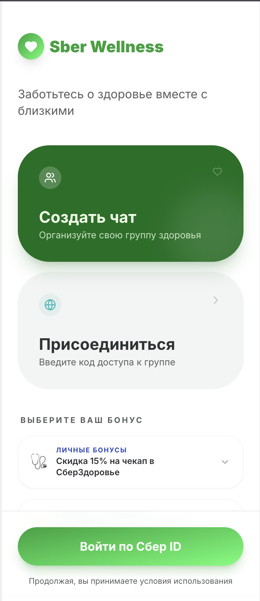
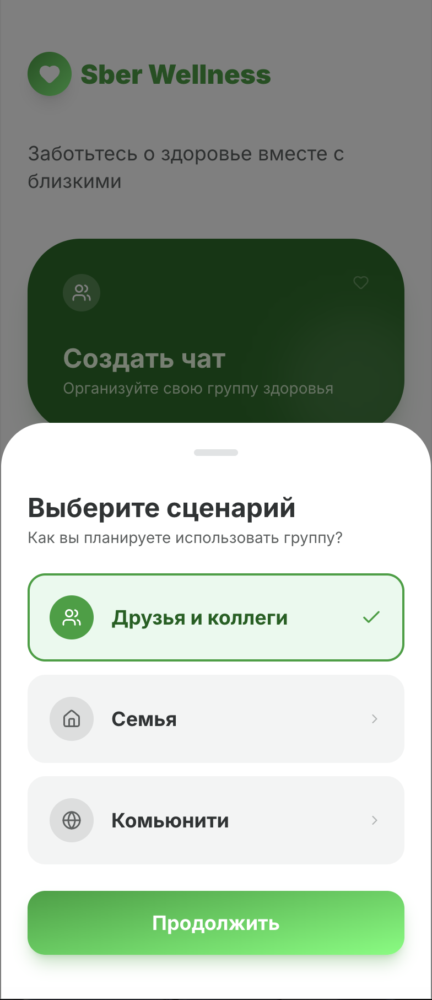
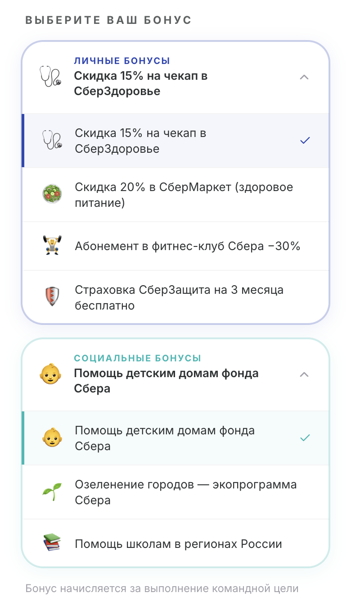
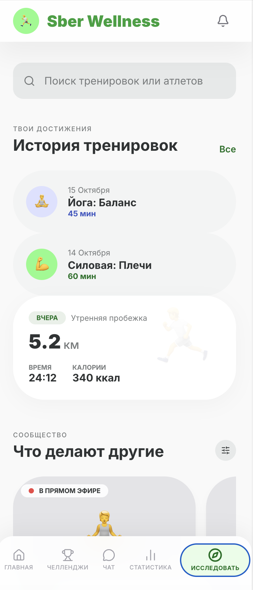
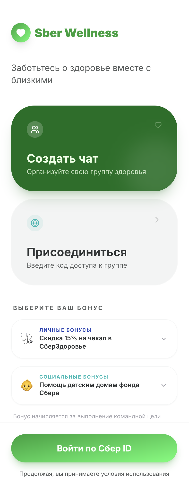
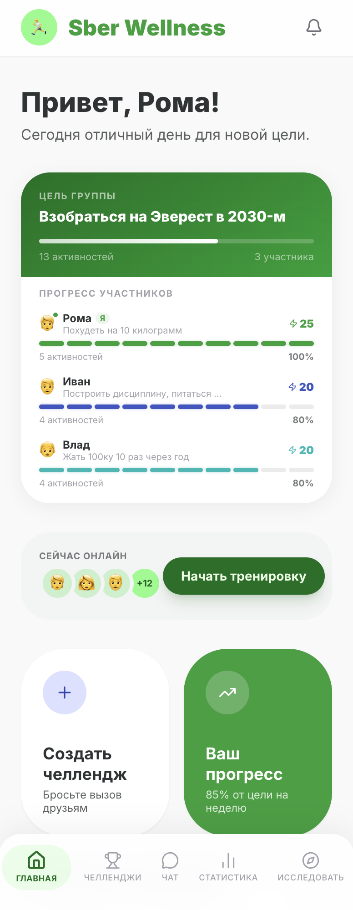
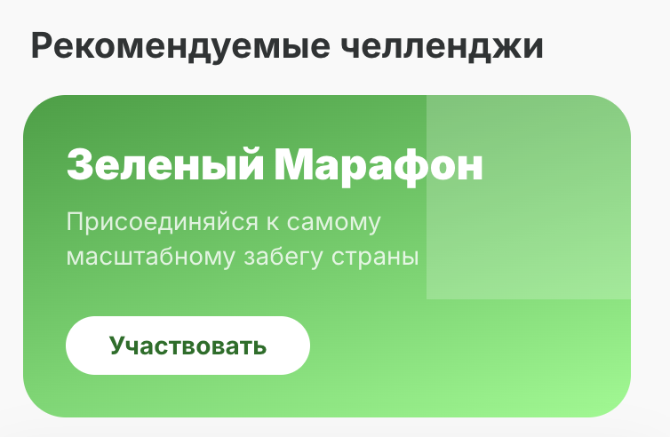
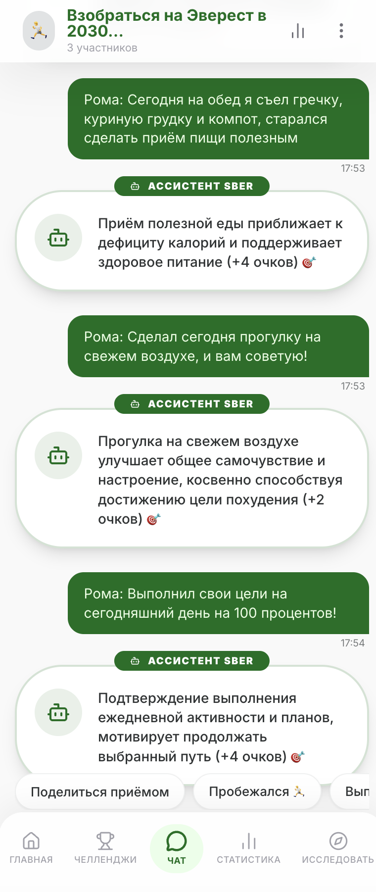
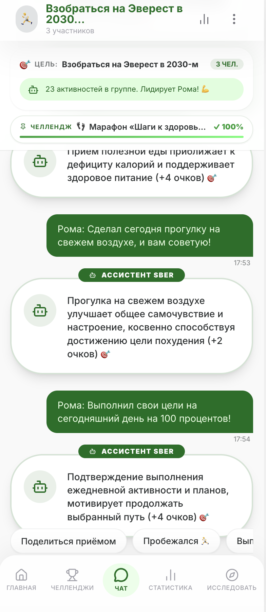
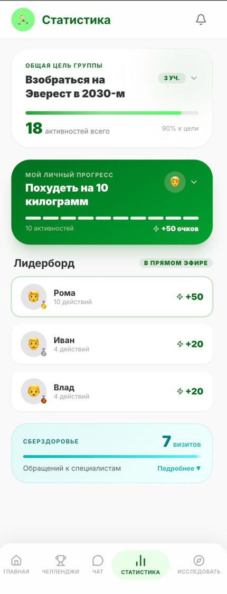

# Zabiray — Sber Wellness App

Мобильное приложение для командного трекинга здоровья и активностей с AI-ассистентом на базе GigaChat.

---


## Команда
- **Жан** — Product & UI/UX: пользовательские сценарии, 
  user flow, дизайн и прототип интерфейса, функциональные требования, 
  участие в AI-assisted разработке фронтенда
- **София** — Frontend / Mobile
- **Азат** — Backend
- **Роман, Айторе** — ML и интеграция GigaChat

## Дизайн и прототипирование
Интерфейс спроектирован и прототипирован в Google Stitch 
до начала разработки. 

Прототип: [Открыть прототип](https://stitch.withgoogle.com/preview/13372998204976024046?node-id=a84697e497184ab78ff9f6a244443129)

<p align="center">
  
  
  
</p>
<p align="center">
  
  
  
</p>
<p align="center">
  
  
  
  
</p>

## Стек

| Часть | Технологии |
|-------|-----------|
| Frontend | React 19, Vite, Lucide Icons |
| Backend | Django 4, Django REST Framework |
| AI | GigaChat SDK (Сбер) |
| БД | CSV-файлы через pandas |

---

## Структура проекта

```
Zabiray/
├── frontend/          # React-приложение (SPA, 390px mobile)
│   └── src/
│       ├── pages/
│       │   ├── Home.jsx        — Главная: цели группы, прогресс участников
│       │   ├── Chat.jsx        — Групповой чат с AI-ассистентом
│       │   ├── Stats.jsx       — Статистика: лидерборд, СберЗдоровье
│       │   ├── Challenges.jsx  — Челленджи: создание и прогресс
│       │   ├── Explore.jsx     — Исследование активностей
│       │   └── Landing.jsx     — Онбординг и выбор бонусов
│       ├── components/
│       │   └── BottomNav.jsx   — Нижняя навигация
│       └── api.js              — HTTP-клиент (fetch → Django API)
├── backend/
│   └── api/
│       ├── views.py            — REST-эндпоинты
│       ├── urls.py             — URL-маршруты
│       └── gigachat_service.py — Интеграция с GigaChat
├── data/
│   ├── users.csv        — Пользователи (id, name, goal)
│   ├── chats.csv        — Чаты (id, goal, users)
│   ├── messages.csv     — Сообщения (id, user_id, chat_id, message, date)
│   └── generate_mock.py — Генератор тестовых данных
└── response/
    ├── authorization_key.txt
    ├── personal_response.py   — Промпт для персонального AI-ответа
    └── group_response.py      — Промпт для групповой сводки дня
```

---

## Запуск

### Backend

```bash
cd backend
python3 -m venv venv
source venv/bin/activate
pip install -r requirements.txt
python manage.py runserver
# API доступно на http://localhost:8000/api/
```

### Frontend

```bash
cd frontend
npm install
npm run dev
# Приложение открывается на http://localhost:5173/
```

### Генерация тестовых данных

```bash
cd data
/path/to/venv/bin/python3 generate_mock.py
# Создаёт users.csv, chats.csv, messages.csv с данными для 3 участников
```

---

## API-эндпоинты

| Метод | URL | Описание |
|-------|-----|---------|
| GET | `/api/users/` | Список пользователей |
| GET | `/api/users/<id>/` | Профиль пользователя |
| GET | `/api/chats/` | Список чатов с участниками |
| GET | `/api/chats/<id>/` | Детали чата |
| GET | `/api/chats/<id>/messages/` | Сообщения чата |
| POST | `/api/chats/<id>/send/` | Отправить действие → получить AI-ответ |
| GET | `/api/stats/` | Статистика + лидерборд |
| GET | `/api/chats/<id>/summary/` | Дневная сводка от GigaChat |

### POST `/api/chats/<id>/send/`

```json
{
  "user_id": 1,
  "action_text": "Пробежал 3 км"
}
```

Ответ:
```json
{
  "user_message": { ... },
  "ai_message": { ... }
}
```

---

